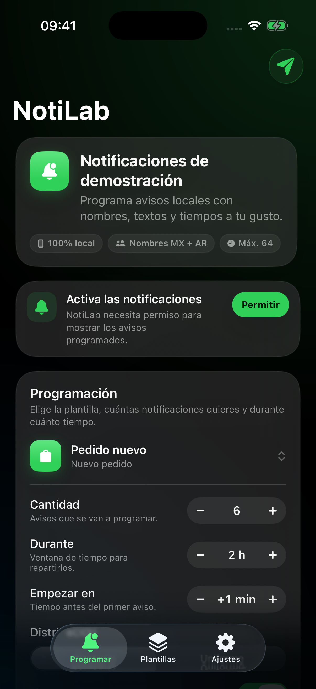
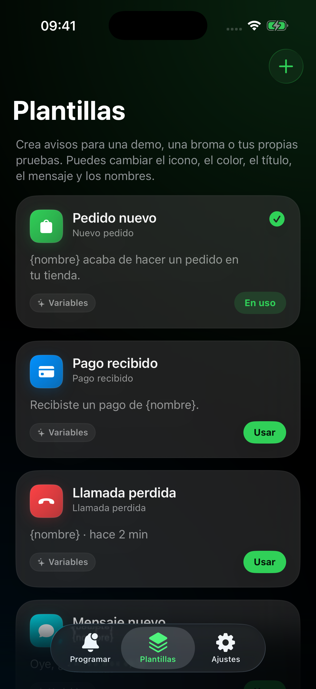
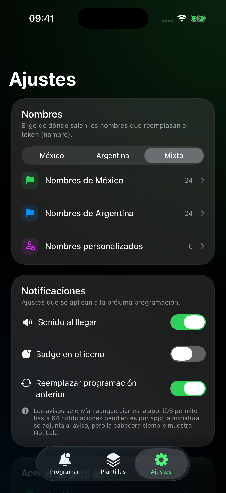

# NotiLab

NotiLab es una app nativa de iPhone para programar **notificaciones locales de demostración** con nombres, textos, iconos, colores y tiempos personalizables. Está pensada para pruebas, contenido, bromas y demos.

> Las notificaciones siempre muestran el nombre e icono de **NotiLab**. No suplantan a otras apps, marcas ni llamadas reales. Todo se ejecuta en tu iPhone.

## Funciones

- **Programación flexible**: elige cuántas notificaciones quieres (1–64) y repártelas de forma aleatoria o uniforme durante una ventana de tiempo configurable.
- **Se envían al cerrar la app**: iOS entrega las notificaciones locales programadas aunque la app no esté abierta.
- **Nombres de México y Argentina**: listas incluidas, selección de región mixta y nombres personalizados.
- **Tokens**: usa `{nombre}`, `{ciudad}` o `{monto}` en el título o el mensaje.
- **Plantillas personalizables**: título, mensaje, icono, color y nombre de la plantilla. Vienen seis presets de tienda, pago, llamada perdida, mensaje, envío y recordatorio.
- **Vista previa** de la notificación antes de programarla.
- **Prueba en 5 segundos** desde la pantalla principal.
- **Ajustes**: sonido, badge, reemplazo de programaciones anteriores y restauración de valores.
- **Privacidad primero**: no hay cuentas, servidores ni analytics. Todo se guarda en `UserDefaults` en el dispositivo.

## Límites de iOS

- El sistema permite un máximo de **64 notificaciones pendientes** por app. Si pides más, se recortan a 64.
- Las notificaciones locales muestran el nombre e icono de NotiLab. **No es posible** mostrar el nombre de Shopify, WhatsApp, una llamada telefónica real u otra app desde una notificación local.
- Una llamada entrante real requiere CallKit y un servidor VoIP; NotiLab no simula el sistema de llamadas. El preset “Llamada perdida” es solo una notificación de demostración.
- La entrega exacta depende de iOS, el modo Concentración y los ajustes de notificaciones del usuario.

## Requisitos

- iPhone con iOS 17.0 o posterior.
- IPA sin firmar para instalar con Sideloadly, AltStore o SideStore con una cuenta de Apple gratuita.
- Para compilar desde cero: macOS con Xcode y [XcodeGen](https://github.com/yonaskolb/XcodeGen).

## Compilar

```bash
xcodegen generate
xcodebuild -project NotiLab.xcodeproj -scheme NotiLab -configuration Release \
  -sdk iphoneos -destination 'generic/platform=iOS' \
  CODE_SIGNING_ALLOWED=NO CODE_SIGNING_REQUIRED=NO build
```

El flujo de [Codemagic](codemagic.yaml) genera automáticamente:

- `NotiLab-unsigned.ipa`
- su SHA-256
- capturas del simulador

## Capturas

| Programar | Plantillas | Ajustes |
| --- | --- | --- |
|  |  |  |

## Instalar el IPA

1. Descarga `NotiLab-unsigned.ipa`.
2. Arrástralo a Sideloadly con el iPhone conectado.
3. Firma con tu Apple ID.
4. Confía en el certificado desde Ajustes > General > VPN y gestión de dispositivos.
5. Activa las notificaciones cuando la app las pida.

La firma gratuita caduca a los 7 días; vuelve a firmar el IPA para renovarla.

## Estructura

```text
NotiLab/
├── NotiLab/
│   ├── App/            # entrada, tema y AppDelegate
│   ├── Models/         # plantillas, nombres, configuración
│   ├── Services/       # programación con UserNotifications
│   ├── ViewModels/     # estado y persistencia
│   ├── Views/          # Programar, Plantillas, Ajustes
│   └── Resources/      # icono y colores
├── project.yml
├── codemagic.yaml
└── docs/screenshots/
```
